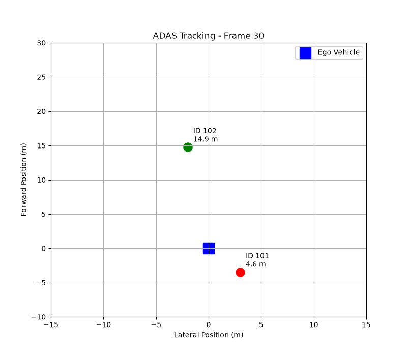

# ADAS Moving Object Visualization

A Python-based bird's-eye-view simulation of moving objects around an ego vehicle, inspired by automotive ADAS visualization systems.

## Features

- Simulates three moving objects with predefined track IDs
- Updates object positions using velocity and time
- Calculates distances relative to the ego vehicle
- Displays an animated bird's-eye view using Matplotlib
- Highlights objects within a 10-metre threshold

## Technologies

- Python
- Matplotlib
- Basic kinematics and coordinate geometry

## Run the Project

Install dependencies:

`pip install -r requirements.txt`

Run:

`python tracker.py`

## Demo

## Future Improvements

- Kalman filter for object motion estimation
- Track creation, association, and deletion
- Simulated camera and radar measurements
- Sensor fusion
- ROS 2 integration
- C++ implementation

## Limitations

This is an independent educational simulation using synthetic data and predefined object IDs. It does not perform real object detection, sensor fusion, or collision-risk assessment.